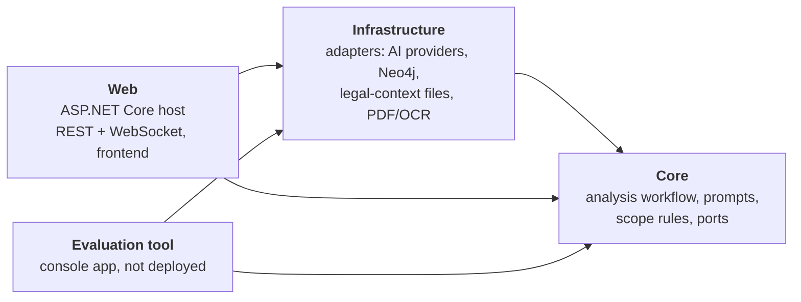

# Contract analysis for Austrian rental law

An AI assistant that checks Austrian residential rental contracts clause by clause against the applicable tenancy law, grounded in curated legal references, together with an evaluation that measures how well different language models do this.

**[Open the evaluation report](https://alur007.github.io/contract-analysis-showcase/)**: interactive charts, works in any browser.

## The problem

General-purpose language models are unreliable on legal questions. In a 2024 study, they hallucinated in 58% (GPT-4) to 88% (Llama 2) of direct, verifiable questions about U.S. federal court cases ([Dahl et al., *Journal of Legal Analysis*](https://doi.org/10.1093/jla/laae003)). This project grounds every analysis in the legal references that apply to the contract, and measures, instead of assuming, how well each model uses them.

## What the application does

1. The user uploads a rental contract (PDF, image or text) and answers a few questions that decide which parts of the Mietrechtsgesetz (MRG) apply: full, partial or none.
2. The contract is checked for readability and contract type.
3. Six sections run in parallel: costs, term, use, maintenance, duties and privacy. Each gets the legal references for its section and scope, from a Neo4j knowledge graph.
4. The report gives each section a risk level (green, yellow, red) with a summary, the quoted clauses, an assessment and its legal basis, plus an overall rating. It is sent to the browser over a versioned WebSocket protocol.

This is a portfolio prototype, not legal advice.

## Sample legal assessment

**[Open the sample assessment](https://alur007.github.io/contract-analysis-showcase/sample.html)**: a fictional rental contract with deliberately one-sided clauses, analysed by the application with gpt-5.6-sol and shown unedited, in German.

It rates all six sections and the contract as a whole red (high risk). Among its findings:
- a deposit that earns no interest, contrary to § 16b MRG;
- a void waiver of the tenant's claims for improvements (§ 10 MRG);
- maintenance duties shifted from the landlord to the tenant;
- an irrevocable consent to passing on personal data.

All 57 quoted passages occur verbatim in the contract, as checked by the evaluation tool. This is a single run; the evaluation shows how consistent the model is across repeats.

## Architecture: a layered monolith with clean dependencies

One deployable ASP.NET Core application, split into layers whose dependencies point only inwards. Business logic does not know about the web, the database or the AI provider.

- **Core** holds the analysis workflow and the domain rules. It reaches files, AI models and the graph only through ports (interfaces). It has no reference to ASP.NET Core, Neo4j, an AI SDK, the DI container or the file system.
- **Infrastructure** implements the ports. AI providers (OpenAI, Nebius, Gemini) are interchangeable through configuration.
- **Web** is the composition root: endpoints, WebSocket handling and the frontend.
- **The evaluation tool** has its own inner layers (Domain → Application → Infrastructure → CLI) and runs the real analysis pipeline through the same registration as the web app. It never ships with it.

The rules are enforced by tests, not by convention:
- **Architecture tests** check the direction twice: on the compiled assemblies (what the code uses) and on the project files (what a project may use).
- **The publish check:** no production project may reference the evaluation tool, and CI fails if any of its files appear in the Web publish output.
- **Characterization tests** record every AI request (prompt and JSON schema) and the full report of an analysis against a fake AI. A refactoring must leave them unchanged.
- **Offline tests:** all tests run without API keys or external services, and CI runs them for every pull request.

## The evaluation

The evaluation tool compares models and retrieval modes on three rental contracts, with repeated runs. It separates what can be measured exactly from what needs judgement.

**Deterministic metrics**, computed offline from the stored runs:
- Legal-reference coverage against 24 curated expected-reference profiles;
- Consistency of the risk rating and of the cited references across repeats;
- Quote traceability: whether each quoted clause occurs in the contract, as a viewer would need for highlighting;
- Guardrails against phrasing that sounds like legal advice.

**LLM judge:**
- Scores each section from 0 to 2 for legal references, clause citation and reasoning (IRAC).
- The judge comes from a different provider than the models it judges.
- It runs in two variants, independent and with the expected references shown, and they are never averaged.
- The report adds the share of sections that got the full score.

**Selected results** (details and caveats in the report):
- **Grounding matters.** In the earlier thesis evaluation, retrieving the legal references raised GPT-4.1's core coverage from 60% (prompt only) to 93% (knowledge graph). The coverage metric expects exactly the references the graph provides, so part of that rise is by construction.
- **Coverage is not correctness.** Among five current models, Inkling 2 Small cited the expected references most often (98.8% vs 95.4% for gpt-5.6-sol). Yet the judge found nothing to fault in its legal references in only 22% of sections, against 70% for gpt-5.6-sol.
- **Judges differ.** A second judge scored the same runs much more strictly, so judge scores are compared only within one judge.

Limits: three contracts, a small number of repeats, and the judges' legal findings have not been checked by a lawyer.

## Tech stack

.NET 10, ASP.NET Core, Neo4j, OpenAI .NET SDK (also for the Nebius and Gemini endpoints), xUnit, NetArchTest, Vega-Lite (report charts).

## About the report

The [evaluation report](https://alur007.github.io/contract-analysis-showcase/) is generated by the evaluation tool's `report` command and published from the `gh-pages` branch. It contains scores and labels only: no contract text, no generated analysis text and no judge findings.
