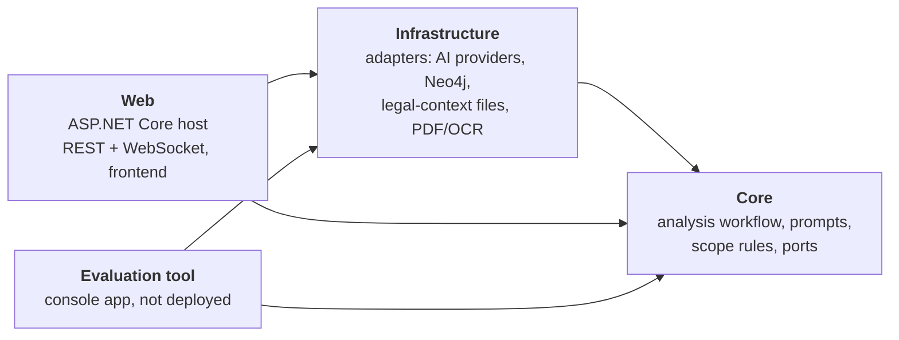

# Contract analysis for Austrian rental law

An AI assistant that analyzes Austrian residential rental contracts clause by clause against the applicable tenancy law, grounded in curated legal references, together with an evaluation that measures how well different language models perform.

By Alena Urbel · started as my bachelor's thesis in Business Informatics (FH Vorarlberg, 2026), since extended into a standalone application and a model evaluation tool.

**[See a sample assessment](https://alur007.github.io/contract-analysis-showcase/sample.html)**: a fictional rental contract, analysed by the application with gpt-5.6-sol and shown unedited, in German.

**[Open the evaluation report](https://alur007.github.io/contract-analysis-showcase/)**: how well five current models perform the analysis, with interactive charts.

This is a prototype, not legal advice.

## Key findings

Three real rental contracts, repeated runs per model. Details, spreads and caveats are in the report.

1. Curated legal context did most of the work; the graph added little. In the thesis evaluation (GPT-4.1), core reference coverage rose from 60% with the prompt alone to 89% with curated legal-context files, and to 93% with retrieval from the Neo4j graph. Part of the last step is by construction: the graph returns exactly the references the coverage metric expects. The thesis judge saw only a small gain in legal references (1.11 → 1.22 → 1.22 on a 0–2 scale), and its overall score did not improve, because clause-citation scores fell.
2. Citing the right law is not the same as applying it. Of the two current models the judge scored, Inkling-2-Small cited more of the expected references (98.8% vs 95.4% for gpt-5.6-sol). Yet the judge found nothing to fault in its legal references in 22% of sections, against 70% for gpt-5.6-sol. Ranked by coverage and ranked by the judge, the two models come out in opposite order.
3. Temperature 1 did not cost consistency here. gpt-5.6-sol and gpt-6.1-sol, which accept only temperature 1, gave every section the same risk level in every repeat (100%). The three models run at temperature 0 reached 50–89%. With three contracts and three repeats each, this is an observation, not a general result.
4. Models rarely quote verbatim. Every passage could be located for 41–70% of quote blocks. Across the benchmark, 87–95% of individual passages could be located. Models join clauses from different sections or change a word, so highlighting a quote in the original document has to work passage by passage.

## The problem

General-purpose language models are unreliable on legal questions. In a 2024 study, they hallucinated in 58% (GPT-4) to 88% (Llama 2) of direct, verifiable questions about U.S. federal court cases ([Dahl et al., *Journal of Legal Analysis*](https://doi.org/10.1093/jla/laae003)). This project grounds every analysis in the legal references that apply to the contract, and measures, instead of assuming, how well each model uses them.

## What the application does

1. The user uploads a rental contract (PDF, image or text) and answers a few questions that decide which parts of the Mietrechtsgesetz (MRG) apply: full, partial or none.
2. The contract is checked for readability and contract type.
3. Six sections run in parallel: costs, term, use, maintenance, duties and privacy. Each gets the legal references for its section and scope, from a Neo4j knowledge graph.
4. The report gives each section a risk level (green, yellow, red) with a summary, the quoted clauses, an assessment and its legal basis, plus an overall rating. It is sent to the browser over a versioned WebSocket protocol.

This is a portfolio prototype, not legal advice.

## Sample legal assessment

**[Open the sample assessment](https://alur007.github.io/contract-analysis-showcase/sample.html)**: a fictional rental contract with deliberately one-sided clauses, analysed by the application with gpt-5.6-sol and shown unedited, in German.

It rates all six sections and the contract as a whole red (high risk). Among its findings:
- a deposit that earns no interest, contrary to § 16b MRG;
- a void waiver of the tenant's claims for improvements (§ 10 MRG);
- maintenance duties shifted from the landlord to the tenant;
- an irrevocable consent to passing on personal data.

All 57 quoted passages occur verbatim in the contract, as checked by the evaluation tool. This is a single run; the evaluation shows how consistent the model is across repeats.

## Architecture: a layered monolith with clean dependencies

One deployable ASP.NET Core application, split into layers whose dependencies point only inwards. Business logic does not know about the web, the database or the AI provider.

- **Core** holds the analysis workflow and the domain rules. It reaches files, AI models and the graph only through ports (interfaces). It has no reference to ASP.NET Core, Neo4j, an AI SDK, the DI container or the file system.
- **Infrastructure** implements the ports. AI providers (OpenAI, Nebius, Gemini) are interchangeable through configuration.
- **Web** is the composition root: endpoints, WebSocket handling and the frontend.
- **The evaluation tool** has its own inner layers (Domain → Application → Infrastructure → CLI) and runs the real analysis pipeline through the same registration as the web app. It never ships with it.

The rules are enforced by tests, not by convention:
- **Architecture tests** check the direction twice: on the compiled assemblies (what the code uses) and on the project files (what a project may use).
- **The publish check:** no production project may reference the evaluation tool, and CI fails if any of its files appear in the Web publish output.
- **Characterization tests** record every AI request (prompt and JSON schema) and the full report of an analysis against a fake AI. A refactoring must leave them unchanged.
- **Offline tests:** all tests run without API keys or external services, and CI runs them for every pull request.

## The evaluation

The evaluation tool compares models and retrieval modes on three rental contracts, with repeated runs. It separates what can be measured exactly from what needs judgement.

**Deterministic metrics**, computed offline from the stored runs:
- Legal-reference coverage against 24 curated expected-reference profiles;
- Consistency of the risk rating and of the cited references across repeats;
- Quote traceability: whether each quoted clause occurs in the contract, as a viewer would need for highlighting;
- Guardrails against phrasing that sounds like legal advice.

Failed sections are counted and left out of the scores, instead of being scored as empty answers.

**LLM judge:**
- Scores each section from 0 to 2 for legal references, clause citation and reasoning (IRAC). The report also gives the share of sections with the full score, since the rubric levels are ordinal.
- The main judge, gemini-4-hydrogen, comes from a different provider than both models it scored. A second judge, gpt-6.2-astra, re-scored gpt-5.6-sol as a cross-check and was much stricter: full marks for legal references in 17% of sections, against 70% from the main judge. Judge scores are therefore compared only within one judge.
- Each judge runs in two variants, independent and with the expected references shown, and they are never averaged. The reference list raised the legal-reference scores of every model; the means of the other two dimensions moved by at most 0.17 points.

## Limitations

- Small set of contracts and number of repeats per model.
- The judges' legal findings have not yet been approved by a lawyer.
- The current models ran at different temperatures (0 on Nebius, 1 for the OpenAI models, which accept no other value).
- Coverage in graph mode is partly by construction (see above). The graph covers the MRG scopes; it has no profiles for limited-profit housing (WGG) contracts.

## Source code

The application and the evaluation tool are in a private repository. I'm happy to walk through the code, including the architecture and characterization tests: [linkedin.com/in/alena-urbel](https://www.linkedin.com/in/alena-urbel)

## Tech stack

.NET 10, ASP.NET Core, Neo4j, OpenAI .NET SDK (also for the Nebius and Gemini endpoints), xUnit, NetArchTest, Vega-Lite (report charts).

## About the report

The [evaluation report](https://alur007.github.io/contract-analysis-showcase/) is generated by the evaluation tool's `report` command and published from the `gh-pages` branch. It contains scores and labels only: no contract text, no generated analysis text and no judge findings.
